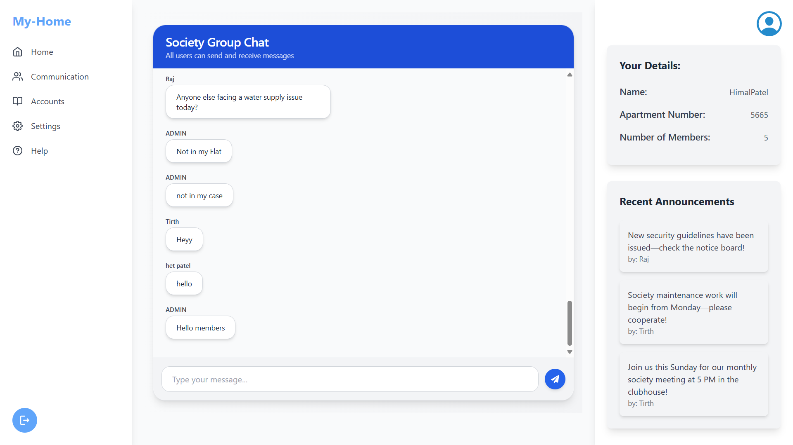
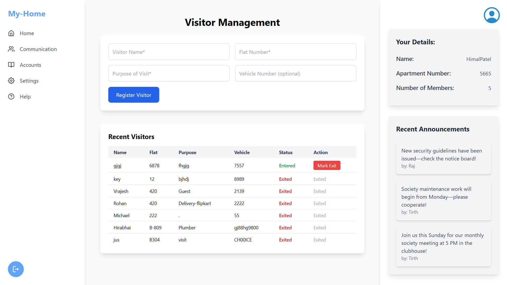
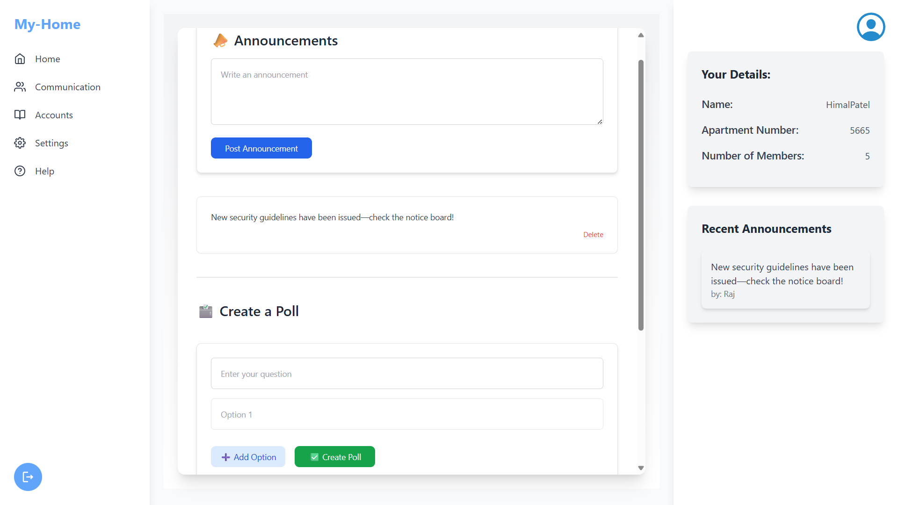

# 🏘️ Society Management System

A modern, responsive society management web app built using **React**, **Tailwind CSS**, and **Firebase**.  
Easily manage members, communication, and settings — with real-time updates and a clean, intuitive UI.

FOR BEST EXPERIENCE OPEN THE WEBSITE ON PC.

🔗 **Live Demo:** [View Project](https://society-management-web.netlify.app/)


incase the link dosent work use : [https://dulcet-kitsune-ef3f47.netlify.app/Login](https://society-management-web.netlify.app/)


---

## ✨ Features
✅ Member management dashboard  
✅ Real-time updates with Firebase  
✅ Modern responsive UI built with Tailwind CSS  
✅ Secure login & authentication  
✅ Clean and modular React components

## ✨ Functions
✅ Dashboard Cards 
✅ User Lists with contact info
✅ Visitor feature
✅ Directory
✅ Event Management
✅ Complain Desk
✅ Security Desk (currently for demo) (will be updated soon with further features)
✅ maintainance Page   
✅ Chat Section (Real time)
✅ Recent Anouncement (Real time)
✅ Create anouncement and Polls Page
✅ Accounts Section (currently demo) (will be updated soon with razorpay pannel with demo payment options)
✅ Settings page (currently under process)
✅ Help Page 
✅ Profile Page

## ✨ Firebase Functions
✅ Include firebase Authentication. 
✅ Include firebase Database.

---

## 🚀 Tech Stack
- ⚛️ **React** – Frontend framework
- 🌬 **Tailwind CSS** – Utility-first styling
- 🔥 **Firebase** – Authentication & real-time database

---

## 📸 Screenshots








---

## 📦 Installation & Setup

Clone the repository:
```bash
git clone https://github.com/Shreyaa1211/Society_Management.git
cd Society_Management

Install dependencies:
npm install

⚠️ Important:
After cloning, replace the Firebase config in:
src/firebase.js
with your own Firebase project's API keys and settings.

Then, start the development server:
npm run dev


